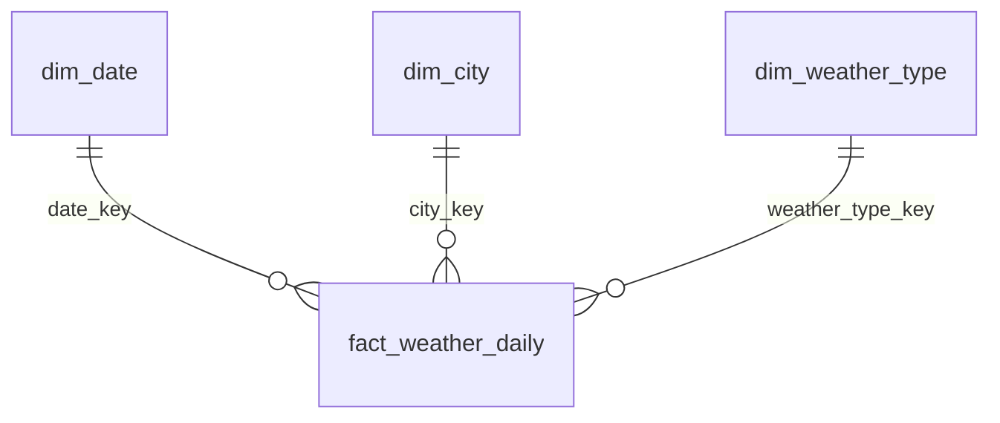

# Weather DWH – star schema

One fact table and three dimensions, built from the raw files written by `notebooks/Ingest_data.ipynb`.
SQL: `sql/01_create_tables.sql` (tables), `sql/02_load_procedures.sql` (load procedures).
Load: `notebooks/Load_dwh.ipynb`.

**Grain of the fact:** one row per city per day.

| Table | Type | Rows | Source |
|---|---|---|---|
| `fact_weather_daily` | fact | 23 cities × ~1,380 days, + 23 per day | `raw_data/weather/deltadate=*/<City>.csv` |
| `dim_date` | SCD0 | one per day in the weather files | dates of `raw_data/weather/...` |
| `dim_city` | SCD1 | 23 | `raw_data/cities/deltadate=*/cities.csv` + grid cell from weather files |
| `dim_weather_type` | SCD0 | 28 + `-1` Unknown | `config/weather_types.csv` (WMO weather codes) |

**Keys.** Every dimension has a surrogate key; the fact only stores those. `dim_city.city_key` is generated
once per city and never changes (SCD1 overwrites attributes, keeps the key). `date_key` (`YYYYMMDD`) and
`weather_type_key` (WMO code) are smart keys – stable values, no lookup table needed.

**Load.**
All data comes from CSV files; the procedures only read the staging tables.
1. `Load_dwh.ipynb` copies the CSV files into staging (columns 1:1 as in the CSV headers):
   `stg.weather_types` ← `config/weather_types.csv`, `stg.cities` ← all `raw_data/cities/deltadate=*/cities.csv`,
   `stg.weather_daily` ← weather files not in the fact yet (deltadate + city).
2. `load_dim_weather_type` and `load_dim_date` run only when codes / dates from staging are missing.
3. `load_dim_city` (SCD1) and `load_fact_weather_daily` (upsert) run every time.
All in one transaction.

---

## fact_weather_daily

| Column | Type | Unit | Source / rule |
|---|---|---|---|
| `date_key` | int | | `date` as `YYYYMMDD` → `dim_date` |
| `city_key` | int | | lookup by `city` → `dim_city` (load fails for cities not in `raw_data/cities`) |
| `weather_type_key` | smallint | | `weather_code` → `dim_weather_type`, `-1` when unknown |
| `temperature_2m_max` | float | °C | raw |
| `temperature_2m_min` | float | °C | raw |
| `temperature_2m_mean` | float | °C | raw |
| `temperature_range` | float | °C | `temperature_2m_max - temperature_2m_min` |
| `apparent_temperature_max` | float | °C | raw |
| `apparent_temperature_min` | float | °C | raw |
| `apparent_temperature_mean` | float | °C | raw |
| `daylight_duration` | float | s | raw |
| `sunshine_duration` | float | s | raw |
| `precipitation_sum` | float | mm | raw |
| `rain_sum` | float | mm | raw |
| `snowfall_sum` | float | cm | raw |
| `precipitation_hours` | float | h | raw |
| `wind_speed_10m_max` | float | km/h | raw |
| `wind_gusts_10m_max` | float | km/h | raw |
| `wind_direction_10m_dominant` | float | ° | raw |
| `shortwave_radiation_sum` | float | MJ/m² | raw |
| `et0_fao_evapotranspiration` | float | mm | raw |
| `deltadate` | date | | raw – which load the row came from |
| `loaded_at` | timestamp | | time of the DWH load |

Primary key: (`date_key`, `city_key`). A reloaded delta replaces existing rows (upsert).

---

## dim_date

| Column | Type | Example |
|---|---|---|
| `date_key` | int, PK | `20261006` |
| `date` | date | 2026-10-06 |
| `year` | smallint | 2026 |
| `quarter` | smallint | 4 |
| `month` | smallint | 10 |
| `month_name` | text | October |
| `iso_week` | smallint | 41 |
| `day_of_month` | smallint | 6 |
| `day_of_year` | smallint | 279 |
| `day_of_week` | smallint | 2 (Monday = 1) |
| `day_name` | text | Tuesday |
| `is_weekend` | bool | false |

Season is **not** here: it depends on the hemisphere (October is autumn in Chicago, spring in Sydney) and is
derived from `dim_city.hemisphere` + `month` in the view below.

---

## dim_city

| Column | Type | Source |
|---|---|---|
| `city_key` | int, PK | generated |
| `city` | text | `city` – name used in the raw files |
| `geonames_id` | bigint | geocoding `id` |
| `country` | text | geocoding `country` |
| `country_code` | text | geocoding `country_code` |
| `country_id` | bigint | geocoding `country_id` (GeoNames id of the country) |
| `population` | int | geocoding `population` |
| `place_type` | text | geocoding `feature_code` (PPLC = capital, PPLA = region capital, PPL = city) |
| `latitude` | float | geocoding `latitude` – coordinates of the place |
| `longitude` | float | geocoding `longitude` |
| `grid_latitude` | float | weather files – grid cell the weather model used |
| `grid_longitude` | float | weather files |
| `elevation` | float | weather files (m, of the grid cell) |
| `timezone` | text | weather files, e.g. `America/New_York` |
| `hemisphere` | text | `North` / `South` from `latitude` |
| `updated_at` | timestamp | last SCD1 change |

Natural key: `city` (name in `raw_data/cities` and the raw weather files). A city that appears in several
city files (re-geocoded) takes the row with the newest deltadate. `geonames_id` is stored as a
more stable id for later. Grid-cell columns keep their old value for cities without new weather rows in staging.

---

## dim_weather_type

| Column | Type | Description |
|---|---|---|
| `weather_type_key` | smallint, PK | WMO weather code (same value as raw `weather_code`) |
| `description` | text | e.g. "Moderate rain" |
| `category` | text | Clear, Cloudy, Fog, Drizzle, Rain, Snow, Storm |
| `intensity` | text | Light / Moderate / Heavy / – |
| `severity` | smallint | 0 none, 1 low, 2 medium, 3 high |
| `is_precipitation` | bool | true for drizzle, rain, snow, storm |
| `is_freezing` | bool | freezing drizzle / rain |

Rows:

| Code | Description | Category | Intensity | Severity |
|---|---|---|---|---|
| 0 | Clear sky | Clear | – | 0 |
| 1 | Mainly clear | Cloudy | Light | 0 |
| 2 | Partly cloudy | Cloudy | Moderate | 0 |
| 3 | Overcast | Cloudy | Heavy | 0 |
| 45 | Fog | Fog | – | 1 |
| 48 | Depositing rime fog | Fog | – | 1 |
| 51 | Light drizzle | Drizzle | Light | 1 |
| 53 | Moderate drizzle | Drizzle | Moderate | 1 |
| 55 | Dense drizzle | Drizzle | Heavy | 1 |
| 56 | Light freezing drizzle | Drizzle | Light | 2 |
| 57 | Dense freezing drizzle | Drizzle | Heavy | 2 |
| 61 | Slight rain | Rain | Light | 1 |
| 63 | Moderate rain | Rain | Moderate | 2 |
| 65 | Heavy rain | Rain | Heavy | 2 |
| 66 | Light freezing rain | Rain | Light | 2 |
| 67 | Heavy freezing rain | Rain | Heavy | 3 |
| 71 | Slight snowfall | Snow | Light | 1 |
| 73 | Moderate snowfall | Snow | Moderate | 2 |
| 75 | Heavy snowfall | Snow | Heavy | 3 |
| 77 | Snow grains | Snow | Light | 1 |
| 80 | Slight rain showers | Rain | Light | 1 |
| 81 | Moderate rain showers | Rain | Moderate | 2 |
| 82 | Violent rain showers | Rain | Heavy | 3 |
| 85 | Slight snow showers | Snow | Light | 1 |
| 86 | Heavy snow showers | Snow | Heavy | 2 |
| 95 | Thunderstorm | Storm | Moderate | 3 |
| 96 | Thunderstorm with slight hail | Storm | Moderate | 3 |
| 99 | Thunderstorm with heavy hail | Storm | Heavy | 3 |

---

## Weather changes – view `v_weather_changes`

Day-over-day changes are computed in a view on top of the fact, so they stay correct with incremental loads
(the previous day is always read from the DWH, not only from the new delta).

| Column | Rule |
|---|---|
| `date_key`, `city_key`, `weather_type_key` | from the fact |
| `season` | Winter / Spring / Summer / Autumn from `month` and `hemisphere` |
| `temperature_mean_change` | `temperature_2m_mean - LAG(temperature_2m_mean)` per city ordered by date |
| `temperature_max_change` | same for `temperature_2m_max` |
| `temperature_min_change` | same for `temperature_2m_min` |
| `precipitation_change` | same for `precipitation_sum` |
| `wind_gusts_change` | same for `wind_gusts_10m_max` |
| `previous_weather_type_key` | `LAG(weather_type_key)` |
| `weather_type_changed` | `weather_type_key <> previous_weather_type_key` |
| `category_changed` | category of today ≠ category of yesterday (e.g. Clear → Rain) |
